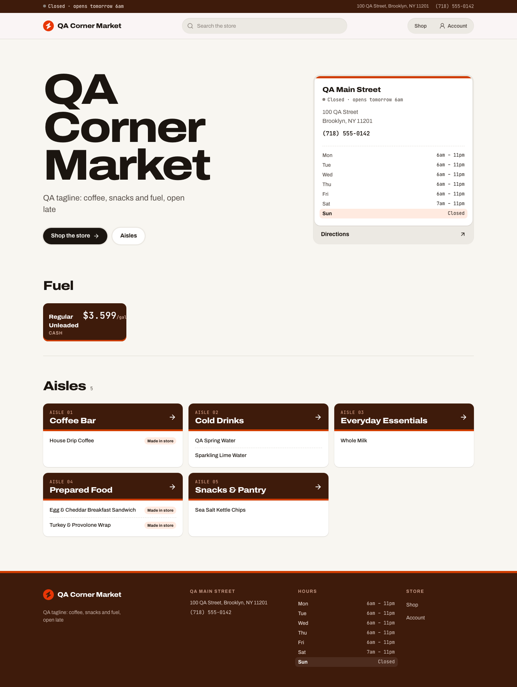
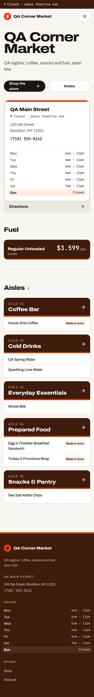
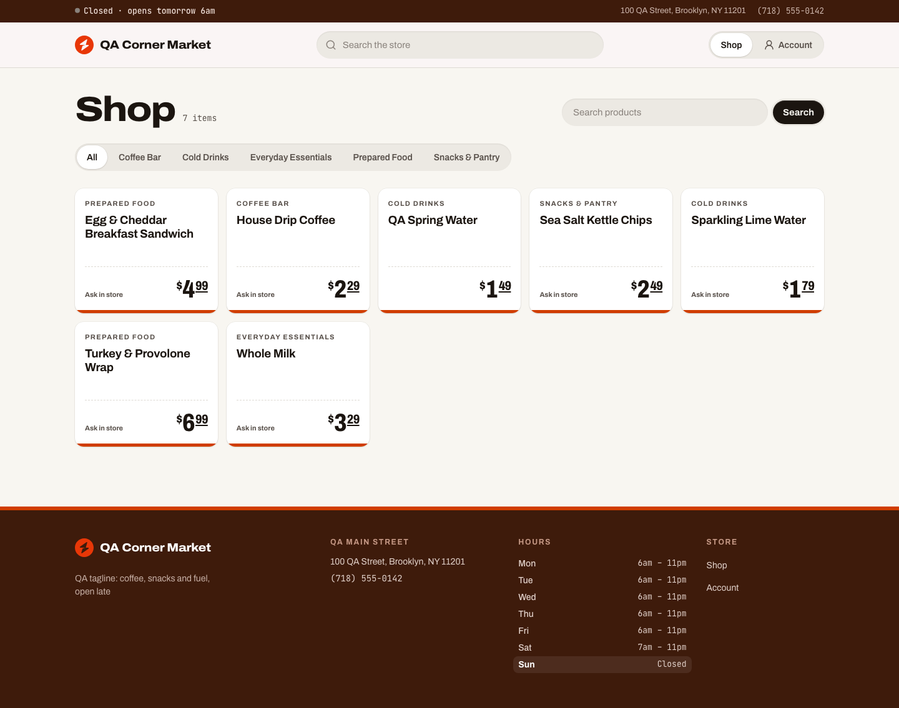
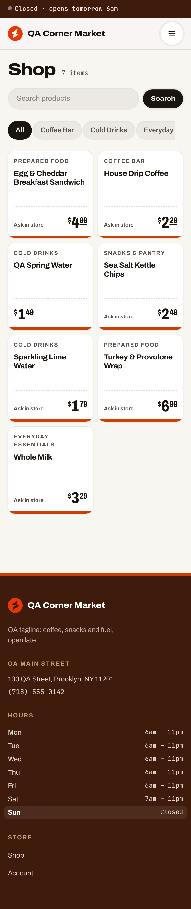

# Night receipt: convenience storefront redesign, 2026-10-25

Live: https://openfront-convenience-production.up.railway.app  
Commits (master, auto-deployed on Railway): a772fc5, 4c2453a, fb0f76b, 87d48a9, e4a33a7  
Brief: `~/Code/Euler/state/briefs/design-skills-redesign-2026-10-25.md` (Openfront Batch 3, storefront only)

## The world
The storefront is the store's register receipt printed at night: a near-black counter tinted toward the logo hue, thermal-white ink and one lit-sign accent from the logo hue (open dot, primary action, current aisle). Doto (dot matrix) sets the store name, prices and totals; Sofia Sans Semi Condensed sets the rest. Items are joined to values by dotted leaders, and slips end in torn edges.

Owner bar applied: dark, considered and premium; no grey washed-out ground; no generic SaaS cards; no gradient or glow; UI copy is labels, states and errors only; phone width works. Tessier (dark editorial poster, objects floating on near-black, one display voice used sparingly) was the reference.

## What changed (presentation only; every route, state and workflow kept)
- Home: the store name in dot matrix sized from its length to span the measure on one line; one receipt-head slip (today's open state, address with directions, phone); a search line with Search and Shop the store; the aisles as an itemised slip whose lines print top-down once, with each item linking to its product; fuel (when posted) and hours slips beside it.
- Shop: products as itemised rows (photo when there is one, name, aisle, options, leader, dot-matrix price) on one torn slip; aisles as a track with the current one solid.
- Product: one receipt holding name, size, description, availability, options with leaders and the price line, with the photo beside it when there is one.
- Account, receipts, sign in and create account restyled in the same world; footer is one receipt foot.
- Contrast fix found in review: element resets now sit at zero specificity, so filled buttons get their dark ink (thermal white on the accent was about 2:1 before).

Routes captured: /, /shop, /shop?category=Cold Drinks, /shop/[productId], /account, /account/signin (basket and checkout redirect to /shop by design).

## Skills used, and how
- **Impeccable** (pbakaus): `impeccable context` loaded project state; `init` wrote `PRODUCT.md` (facts inferred from the repo and the brief, marked as inferred, because the brief ordered no approval stage); `concept-seed --scope direction --mode persuade` rolled the direction against my own ranked list of seven grounded candidates (the roll picked which one to build; challengers were weighed and their disciplines raised into the contract); the direction contract lives in `.impeccable/surfaces/features-storefront.md`; `reference/craft-floor.md` set the build floor; the shipped **impeccable-finish-reviewer** ran a full review, then a verdict pass on the fixes; the **impeccable-documenter** wrote `DESIGN.md` and `.impeccable/design.json` from the shipped code. No image generation was available, so the build was code-led (no comps) and the decision page was skipped (the brief said not to stop for approval).
- **design-taste-frontend** (Leon, tasteskill v2): `draw.mjs` dealt three directions and the full sheet of the chosen one (composition, type system, section blueprints), with slots redrawn only for stated reasons (listed below); the house rules (no eyebrows above headings, no monospace, no tracked tiny capitals, no gradients or glass, no index numbers, two faces at most, 13px type floor) and `lint.mjs` as a gate (0 FAIL on the storefront; deliberate world rules are marked `taste-skill-ignore` with the reason).
- **emil-design-eng**: custom ease-out `cubic-bezier(0.23, 1, 0.32, 1)`, press feedback on every control, hover gated to `(hover: hover) and (pointer: fine)`, entrances from an already-visible default, motion under `prefers-reduced-motion`.
- **frontend-design**: the anti-default calibration (no cream plus serif, no neon on black, no SaaS card kit) and the rule of one bold move per page.
- **high-end-visual-design** and **minimalist-ui** were read; both are opt-in light styles that conflict with the owner's pinned dark direction, so only their restraint on copy and components was used.
- Not used: gpt-taste, creative-director, brand-extract, brandkit, color-expert, animate, prototype, break-ui, mobile-native, pick-ui-library, hallmark, apple-design, taste-design.

Taste-skill direction for this repo: contact-sheet (composition only: name across the top, facts and catalog in the first screen); the hero slot was redrawn because the dealt ring of frames needs 18-24 photos the store doesn't have, and the dealt light palette was translated to the pinned dark.

## Gates (final state)
- Typecheck: `tsc --noEmit -p .` through `heavy-exec.py`, child exit 0, 0 errors, after every batch.
- Parity: `python3 -I platform-parity-audit-2026-10-20/parity-check.py` exit 0, drift 0, missing 0, sidebar-branding ok, sidebar-structure ok, after every batch. Only storefront files changed; the shared dashboard shell and platform pages are untouched.
- Live CSS checked for selectors that exist only in the new stylesheet after each deploy (guards against the Railway stale-compile issue).
- Every route below returned 200 (or the intended 404) on the live site with no horizontal overflow at 1440 and 390.

## Finish review
- Round 1 (fresh impeccable-finish-reviewer): disposition **fix**, with a material-fix list. Every item was applied in one batch, typechecked, parity-checked, pushed and recaptured.
- Round 2 (verdict pass on the recaptures): the remaining partials and small regressions it named were fixed in a final batch. The Impeccable documenter then wrote `DESIGN.md` and `.impeccable/design.json` from the shipped code, and the drift it flagged was cleaned up in the last commit. Two rounds is Impeccable's budget for an unattended run, so no third review ran. The final state hasn't been reviewer-certified as **ship**.

## Open items
- Signed-in states (receipts, receipt detail, rewards) weren't captured, because there's no customer login for the demo. They use the same slip and row classes.

## Before and after
Before: the live site at the start of this work. These shots are on the demo data that existed then; a separate session reset and re-seeded every demo store the same afternoon, so the store name and catalog differ from the after shots.

After (live, 1440 desktop and 390 phone, full page):

- [after-account-desktop.png](design/redesign-20261025/after-account-desktop.png)
- [after-account-phone.png](design/redesign-20261025/after-account-phone.png)
- [after-account_signin-desktop.png](design/redesign-20261025/after-account_signin-desktop.png)
- [after-account_signin-phone.png](design/redesign-20261025/after-account_signin-phone.png)
- [after-home-desktop.png](design/redesign-20261025/after-home-desktop.png)
- [after-home-phone.png](design/redesign-20261025/after-home-phone.png)
- [after-shop-desktop.png](design/redesign-20261025/after-shop-desktop.png)
- [after-shop-phone.png](design/redesign-20261025/after-shop-phone.png)
- [after-shop_category_Cold_20Drinks-desktop.png](design/redesign-20261025/after-shop_category_Cold_20Drinks-desktop.png)
- [after-shop_category_Cold_20Drinks-phone.png](design/redesign-20261025/after-shop_category_Cold_20Drinks-phone.png)
- [after-shop_cmvocev7j004glo0xf8npd953-desktop.png](design/redesign-20261025/after-shop_cmvocev7j004glo0xf8npd953-desktop.png)
- [after-shop_cmvocev7j004glo0xf8npd953-phone.png](design/redesign-20261025/after-shop_cmvocev7j004glo0xf8npd953-phone.png)

Product facts are in `PRODUCT.md`, the direction contract is in `.impeccable/surfaces/features-storefront.md`, and the recorded system is in `DESIGN.md`.
